<p align="center">
  <a href="README-zh_CN.md">简体中文</a> •
  <a href="README-zh_TW.md">繁體中文</a> •
  <a href="README.md">English</a>
</p>

<h1 align="center">AI Switch</h1>

<p align="center">
  <strong>Local AI API Key hub — change once, every tool works</strong>
</p>

<p align="center">
  <a href="https://github.com/kingkate2009-droid/ai-switch/releases"></a>
  <a href="https://github.com/kingkate2009-droid/ai-switch/stargazers"></a>
  <a href="LICENSE"></a>
  
</p>

<p align="center">
  <a href="#why">Why</a> ·
  <a href="#screenshots">Screenshots</a> ·
  <a href="#quick-start">Quick Start</a> ·
  <a href="#what-it-does">What it does</a> ·
  <a href="#docs">Docs</a> ·
  <a href="#supported-backends">Backends</a> ·
  <a href="#license">License</a>
</p>

---

## Why

If you juggle **relay / multi-vendor API keys** across **OpenClaw, OpenCode, Codex CLI, Claude Code**… you already know the pain:

| Pain | Without AI Switch | With AI Switch |
|------|-------------------|----------------|
| Rotate one key | Edit 5 config files by hand | Change once → push to installed tools |
| Bad key | Tool hangs / weird 401s | Health check → strip from backends |
| Wrong write | Silent overwrite | **Sync preview** · uninstalled = no write |
| Onboarding | “Where do I put the key?” | **3-minute path**: add → check → push → test |

**Positioning:** a local **Key hub** (manage · probe · push) — not another chat client.

> One key change. Every installed tool updates. Broken keys don’t take your stack down.

---

## Screenshots

<p align="center">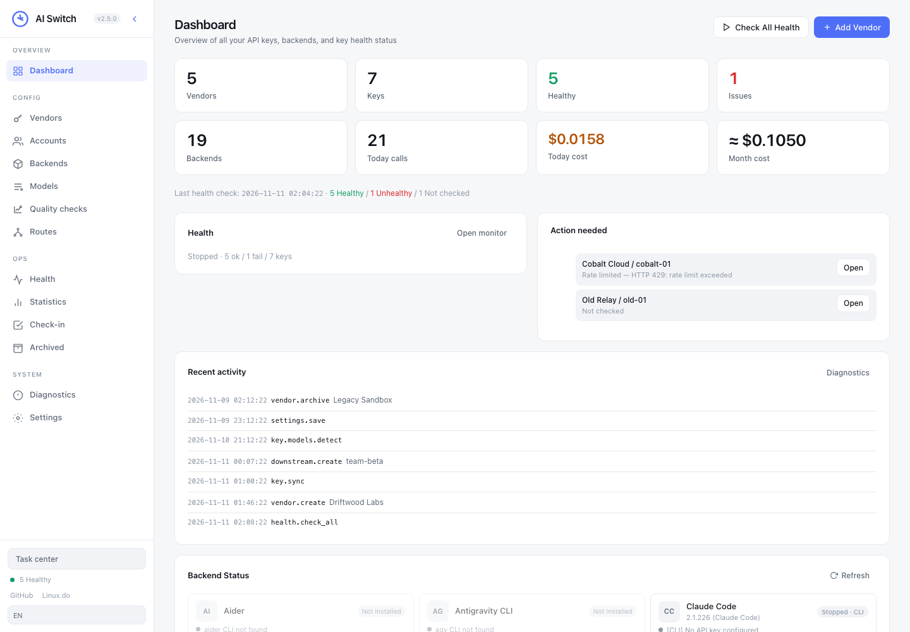</p>

<p align="center">
  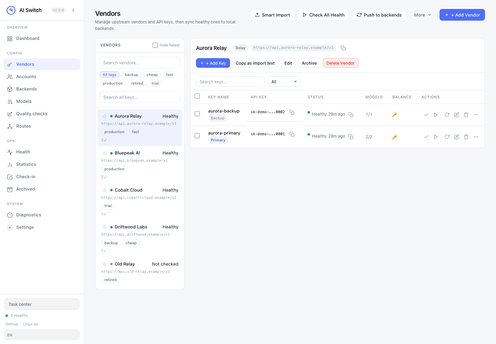
  &nbsp;
  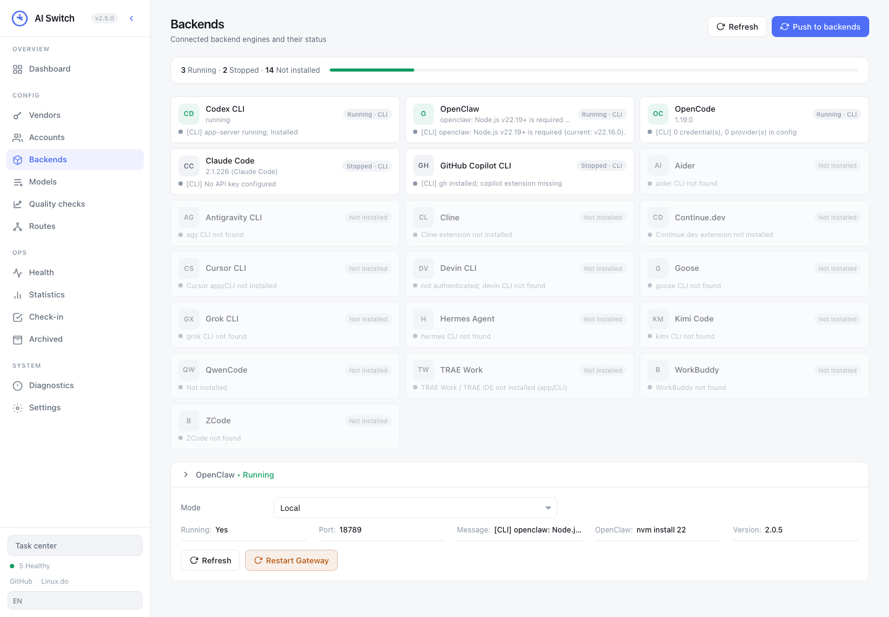
</p>

<p align="center">
  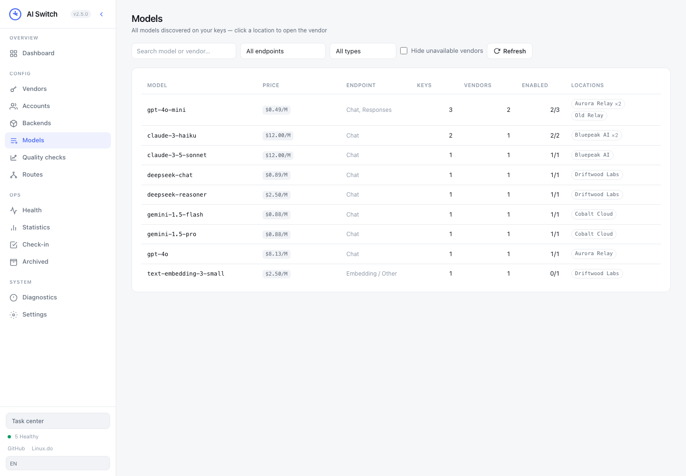
  &nbsp;
  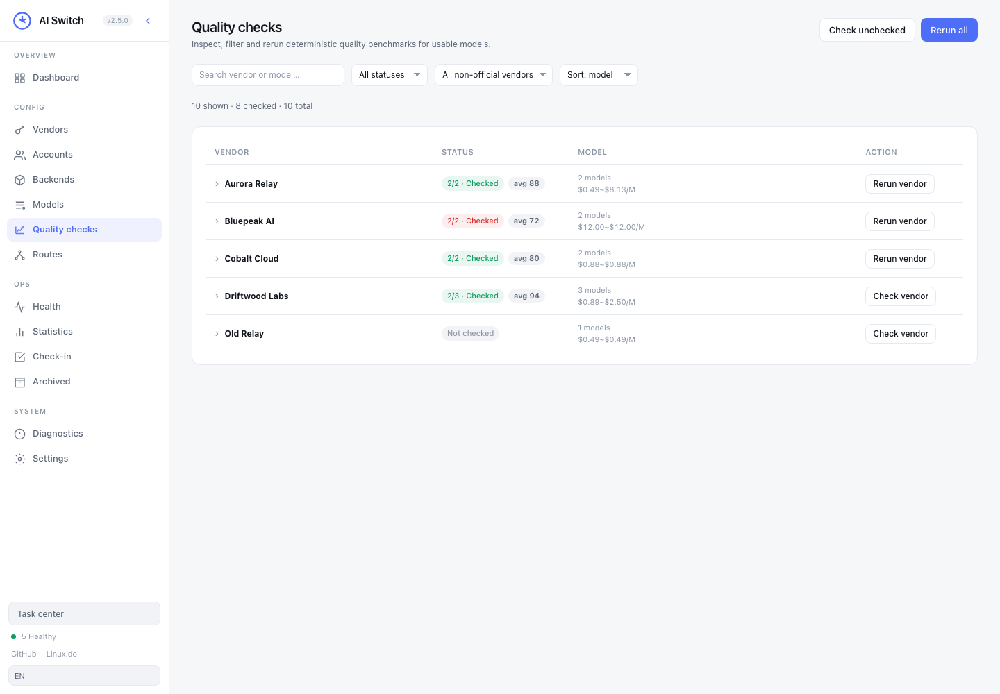
</p>

<p align="center">
  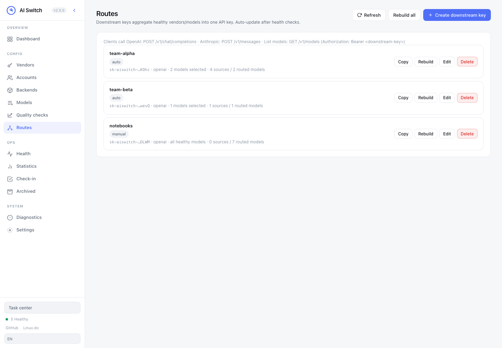
  &nbsp;
  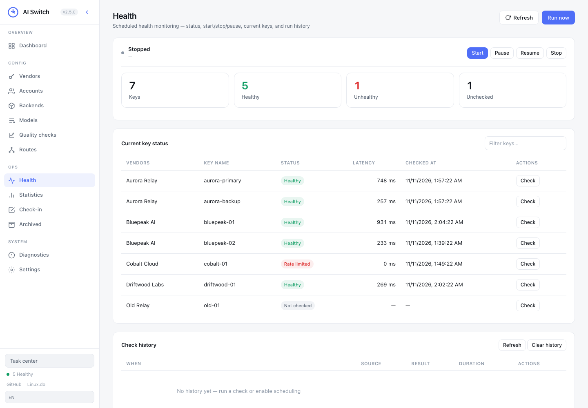
</p>

<p align="center">
  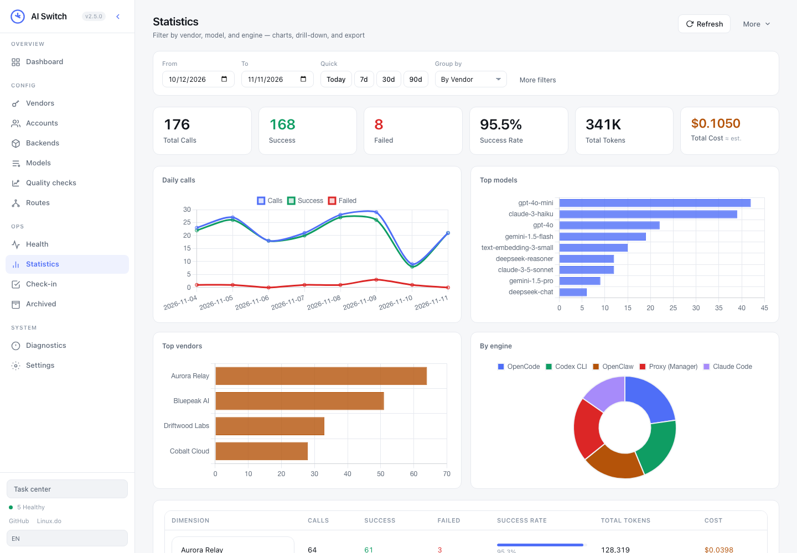
  &nbsp;
  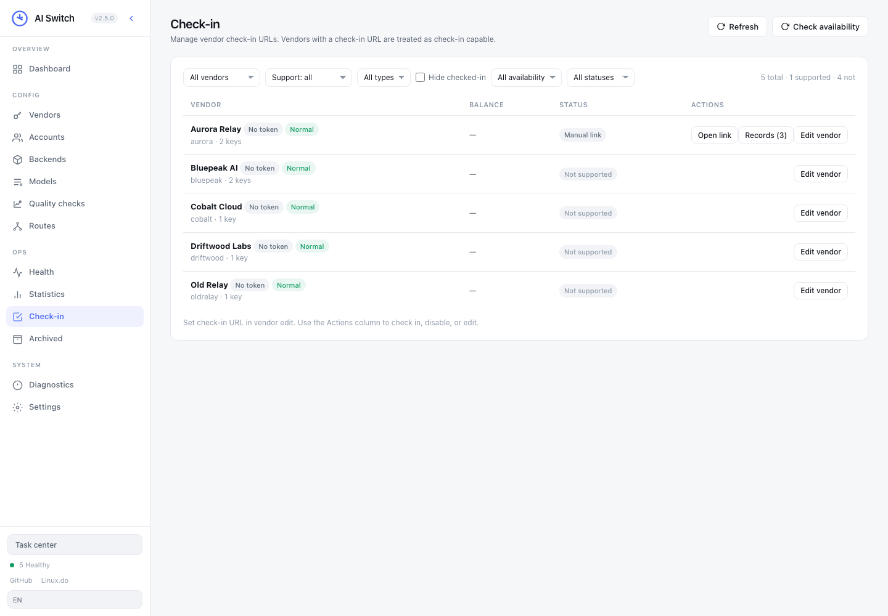
</p>

<p align="center">
  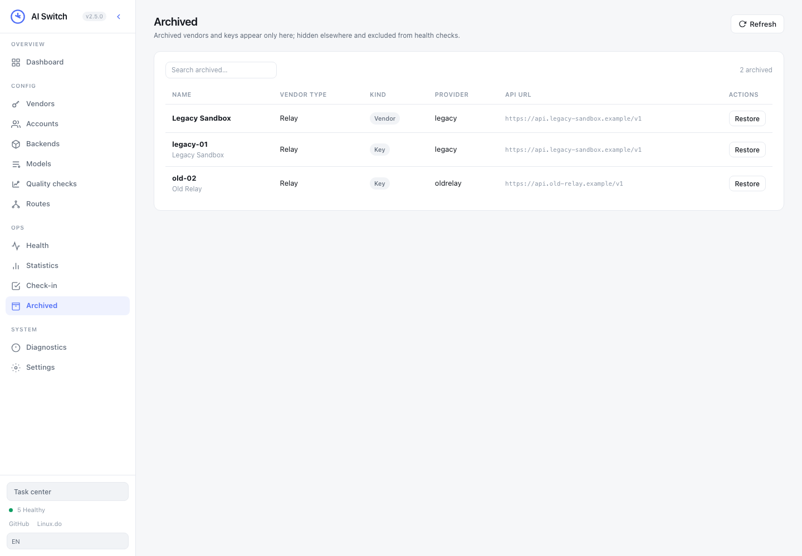
  &nbsp;
  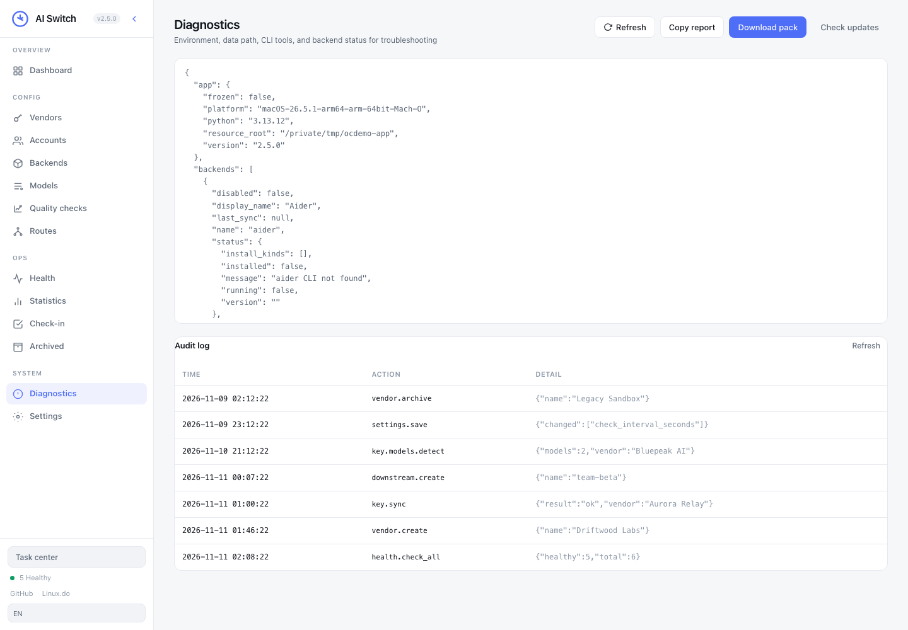
</p>

<p align="center">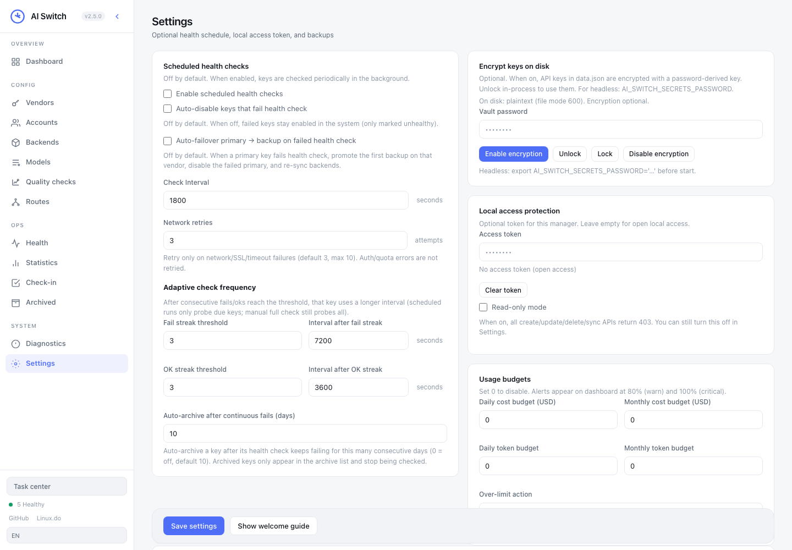</p>

---

## Quick Start

**Easiest:** download a build from [Releases](https://github.com/kingkate2009-droid/ai-switch/releases)  
(Windows / macOS Intel / Apple Silicon / Linux) → extract → run `ai-switch` / `start.bat` / `start.sh`  
→ open **http://127.0.0.1:8787**

**From source:**

```bash
git clone https://github.com/kingkate2009-droid/ai-switch.git
cd ai-switch
pip install -r requirements.txt
python3 run.py
# → http://127.0.0.1:8787
```

**npm (Node.js):**

```bash
npx github:kingkate2009-droid/ai-switch
# → http://127.0.0.1:8787
```

Or install globally:

```bash
npm install -g github:kingkate2009-droid/ai-switch
ai-switch
```

**Docker:**

```bash
docker compose up -d
# → http://127.0.0.1:8787
```

The published port is bound to loopback only. Because the container itself
listens on all interfaces, Docker runs print an **access token** on first start:

```bash
docker compose logs | grep -i "Access token"
```

---

## Network access & the access token

AI Switch stores every API key you own, so how it is reachable matters.

| Bind address | Token | Why |
|---|---|---|
| `127.0.0.1` (default, source/npm) | not required | reachable only from this machine |
| anything routable (`0.0.0.0`, a LAN / Tailscale IP) | **required** | anything that can reach the port could read your keys |

When you bind to a routable address, AI Switch generates a token on first start,
stores it with your data, and prints it:

```
 Bound to 0.0.0.0:8787 — reachable from other machines on your network.
   Access token: 9xK2…  
 Open http://0.0.0.0:8787 and paste it into the login screen.
```

Paste it into the login screen once — the browser session is remembered for 30
days. The token is printed on every start, so a lost token just means reading
the console again.

```bash
AI_SWITCH_HOST=0.0.0.0 python3 app.py     # bind everywhere → token required
AI_SWITCH_ACCESS_TOKEN=… python3 app.py   # inject a token (Docker secrets, systemd)
AI_SWITCH_REQUIRE_AUTH=0 python3 app.py   # disable the token (not recommended)
```

A token you set yourself in **Settings → Access token** is always enforced, even
on `127.0.0.1`. One consequence worth knowing if you mix Docker and source runs:
both use `~/.ai-switch`, so a token generated by a container makes the local
source run ask for it too — clear it in Settings when you no longer want that.

Requires **Python 3.9+** for source/npm installs.

**3-minute loop:** [docs/quickstart.md](docs/quickstart.md)

1. Add vendor + key (or smart import)  
2. Health check passes  
3. Push to backends (**preview first**)  
4. Send `hi` in OpenCode / Codex / Claude Code  

---

## Notifications

AI Switch only tells you something is wrong when you have the page open. Turn on
**Settings → Notifications** and it will come find you instead — off by default,
and nothing leaves your machine until you configure a channel.

| Channel | What to paste |
|---------|---------------|
| **Feishu** | Custom bot webhook URL (`https://open.feishu.cn/open-apis/bot/v2/hook/…`) |
| **Slack** | Incoming webhook URL (`https://hooks.slack.com/services/…`) |
| **Generic** | Any endpoint that accepts a JSON `POST` |

Four events, all on by default (uncheck the ones you don't want):

| Event | Fires when |
|-------|-----------|
| `budget_exceeded` | Usage crosses 80% (warn) or 100% (critical) of a daily/monthly budget |
| `key_failing` | A key crosses the consecutive-failure threshold during health checks |
| `vendor_all_keys_failed` | Every enabled key of a vendor (2+) is failing — that vendor is unusable |
| `sync_failed` | A backend could not be written during a push |

Behaviour worth knowing:

- **Released, not blocking.** Deliveries run on a background thread with an 8s
  timeout, so a dead webhook can never stall a health check or a sync.
- **Repeats are damped.** The same event is not re-sent within *minimum interval*
  (default 60 min), and budget alerts fire at most once per day per level. A
  permanently broken key reminds you periodically instead of every round.
- **Quiet hours.** Set e.g. `23:00-08:00` (wrapping midnight is fine) to mute
  everything except critical events. Leave it empty to always send.
- **Budget alerts don't need health checks.** They are evaluated on their own
  background timer, and also whenever the dashboard refreshes.
- **Test it.** *Send test* delivers one message per configured channel and shows
  the per-channel result. *Recent deliveries* lists what actually went out, with
  the error text when a channel refused the message.
- **Policies don't carry webhooks.** Webhook URLs stay out of exported/shareable
  policy templates, since they are credentials.

Generic webhooks receive:

```json
{
  "source": "ai-switch",
  "event": "key_failing",
  "level": "warning",
  "title": "Key failing: Deepseek / default",
  "message": "3 consecutive failed health checks.",
  "detail": {"vendor": "Deepseek", "key": "default", "fail_streak": 3, "last_error": "HTTP 401"},
  "timestamp": "2026-10-27T07:51:31.250862+00:00"
}
```

---

## Accounts & account switching

AI Switch keeps **login identities** (OAuth / subscription logins) separate from
API keys, and can *switch* which one a local tool is logged in as.

- **Import** a login from the tool's own credential file, or **sign in** with a
  browser OAuth flow.
- **Check official quota** per account (Claude, Codex, …).
- **Switch (换号)** — write a chosen account into the tool's credential store
  (macOS Keychain, `~/.codex/auth.json`, an IDE's `state.vscdb`, …). The previous
  credential is copied to `<file>.ai-switch.bak` first.

Supported so far: **Claude Code, Codex / ChatGPT, Gemini CLI, Grok CLI**, with
Kiro, Cursor, Windsurf, CodeBuddy, Qoder, Trae, Copilot, Antigravity and Zed
following the same adapter contract.

> Switching is an explicit action and is blocked in read-only mode.
> Auto-rotation on quota exhaustion is planned and will be **opt-in, off by
> default**. See [docs/account-switching.md](docs/account-switching.md).

---

## What it does

Only three outcomes matter day-to-day:

1. **One place for keys** — vendors, tags, batch import, MetaAPI merge, dedupe  
2. **Know what’s alive** — model-level endpoint detection, quality checks, readable errors, adaptive interval, **archive of dead keys**
3. **Safe sync** — verified models only · preview · primary/backup failover · never write to uninstalled tools

Also included when you need them: **vendor types (Public/Relay/Raw key)** with filtering in the model catalog & check-in, **archiving** (hide + exclude from health checks + restore), check-in URLs, budgets, **outbound notifications**, encrypted profile export, diagnostics pack, downstream routes, desktop packages.

<details>
<summary><strong>Feature list (expand)</strong></summary>

- Multi-vendor + key table, search / tags / batch enable-disable-delete  
- 26+ built-in providers + custom OpenAI-compatible endpoints  
- Per-model endpoint detection (Chat, Responses, Messages, Gemini) with auto/manual selection
- Vendor-grouped quality checks with per-vendor and per-model actions
- **Vendor types (Public/Relay/Raw key) with filtering in catalog & check-in**
- **Archive view: hide dead vendors/keys everywhere, exclude from health checks, restore anytime**
- Health monitor (scheduled), auto-disable / primary-backup failover (optional)
- **Outbound notifications** — Feishu / Slack / generic webhook for budget, key and sync failures
- **Account switching (换号)** — import OAuth logins, check quota, write an account into the tool's own credential store
- Sync to OpenClaw, OpenCode, Claude Code, Codex, Cline, Aider, Continue, …  
- Batch / backup / MetaAPI import with undo  
- Transactional SQLite state with one-time legacy JSON migration
- npm/npx launcher in addition to source, Docker and desktop packages
- Light/dark theme, EN / 简体 / 繁中  
- Drop-in backend adapters ([contribution guide](docs/adapter-contribution.md))

</details>

---

## Docs

| Doc | For |
|-----|-----|
| [3-minute quickstart](docs/quickstart.md) | First run |
| [Codex won’t connect](docs/troubleshoot-codex.md) | Responses / env / models |
| [Backends](docs/backends.md) | What each engine supports |
| [Volcengine Ark](docs/volcengine.md) | 火山方舟: four presets, which one to pick |
| [free.ai](docs/freeai.md) | Non-OpenAI paths behind an OpenAI-shaped API |
| [Account switching](docs/account-switching.md) | Manage logins & switch a tool's account |
| [Adapter contribution](docs/adapter-contribution.md) | Add a backend |

**Issues / help:** [open an issue](https://github.com/kingkate2009-droid/ai-switch/issues)

- [#1 Install & start](https://github.com/kingkate2009-droid/ai-switch/issues/1)
- [#2 Codex connectivity](https://github.com/kingkate2009-droid/ai-switch/issues/2)
- [#3 Import & merge](https://github.com/kingkate2009-droid/ai-switch/issues/3)
- Latest: [v2.5.0 Release](https://github.com/kingkate2009-droid/ai-switch/releases/tag/v2.5.0) · [notes](docs/release-notes-2.5.0.md)

---

## Development

```bash
pip install -r requirements-dev.txt
python -m pytest tests -q           # access policy / sync safety / notifications / accounts
python tests/check_template_js.py   # syntax-check the inline UI script
```

Every test file also runs standalone (`python3 tests/test_notify.py`), and they
all redirect `HOME` to a throwaway directory, so a test run never touches your
real `~/.ai-switch` data. Notification tests spin up a local HTTP server to
verify real payload delivery.

CI runs both on every push and pull request (`.github/workflows/ci.yml`).

---

## Supported backends

| Backend | Notes |
|---------|--------|
| OpenClaw | `openclaw.json`, auth profiles, models |
| OpenCode | `auth.json`, `opencode.jsonc` |
| Claude Code | `settings.json`, `~/.claude.json` |
| Codex CLI | `auth.json`, `config.toml` + Responses health |
| Cline / Aider / Continue.dev | IDE / CLI configs |
| Hermes Agent, QwenCode, Kimi Code, TRAE Work | See [backends.md](docs/backends.md) |

Status on the Backends page: **Not installed** · **Stopped (syncable)** · **Running** — uninstalled tools are never written.

### Model endpoint types

| Type | Examples |
|------|----------|
| `openai_chat` | OpenAI, DeepSeek, OpenRouter, Groq, Moonshot, Qwen, … |
| `anthropic` | Anthropic-compatible |
| `gemini` | Google Gemini |
| `openai_responses` | Codex-oriented `/v1/responses` path |

Endpoint support is detected per model. Automatic mode uses verified endpoints; manual mode lets you choose among detected formats. Backend sync only includes models with a recent successful health and endpoint check. Quality checks send four short requests per model and may consume provider quota.

---

## Desktop packages

| Platform | Asset pattern on Releases |
|----------|---------------------------|
| Windows x64 | `ai-switch-<ver>-windows-amd64.zip` |
| macOS Intel | `ai-switch-<ver>-macos-amd64.tar.gz` |
| macOS Apple Silicon | `ai-switch-<ver>-macos-arm64.tar.gz` |
| Linux x64 | `ai-switch-<ver>-linux-amd64.tar.gz` |

```bash
# Local package
bash scripts/build_package.sh
# Multi-platform release via CI
./release.sh v2.4.0
```

---

## Configuration & security

| Item | Path |
|------|------|
| Data | `~/.ai-switch/ai-switch.db` |
| Usage | `~/.ai-switch/usage.json` |
| Port | `8787` (`AI_SWITCH_PORT`) |

Existing `data.json` state is imported once; legacy files are retained with a `.legacy` suffix for rollback. The configured port is fixed: startup exits with a clear error if the port is occupied.

> **Keys live only under `~/.ai-switch/`.** Never commit that directory. Optional access token in Settings for LAN exposure.

**Stack:** Python + Flask · vanilla JS · SQLite storage · pluggable adapters · Apache 2.0

---

## Links

- [Releases](https://github.com/kingkate2009-droid/ai-switch/releases)  
- [Issues](https://github.com/kingkate2009-droid/ai-switch/issues)  
- [Linux.do](https://linux.do/) — community discussion  

## License

Apache 2.0
